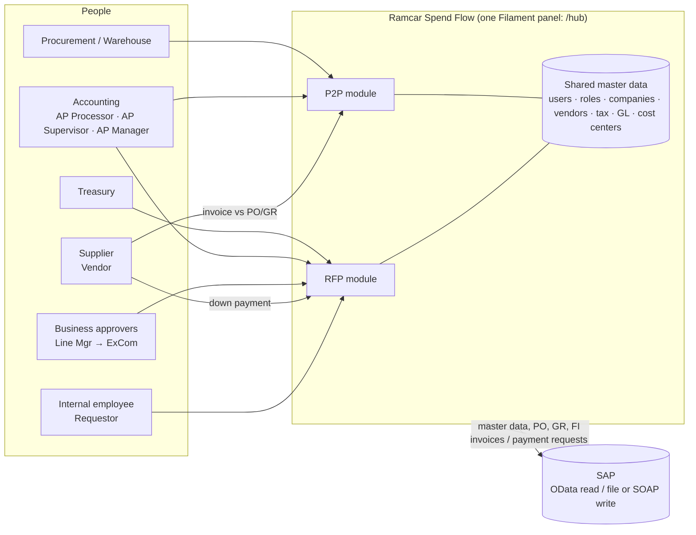

# Roadmap & System Flow

_Last updated: 2026-10-06_

> **Current scope:** no SAP integration yet. Wherever SAP data is needed, we use **generic demo data**. SAP connections are added in a later phase.

Status key: ✅ done · 🔜 next · ⬜ planned · ⏸ parked

## 1. The system at a glance

**Link between the two modules:** a supplier can request a **down payment through RFP** (e.g. 10%). The **remaining balance (e.g. 90%)** is invoiced through **P2P** against the PO/GR.

## 2. Phases

### Phase 0 — Foundation ✅
| Feature | Status |
|---|---|
| Laravel 13, Filament 5, Livewire 4, Tailwind 4, Pest | ✅ |
| One panel `/hub` with login, password reset, profile, database notifications | ✅ |
| Pulse (monitoring), activity log, impersonation (admin "log in as") | ✅ |

### Phase 1 — Master data & access ✅ (done 2026-10-06)
| Feature | Status |
|---|---|
| Shared master tables: companies, currencies, exchange rates, vendor account groups, payment methods, G/L accounts, cost centers (+ allowed G/L), VAT codes, withholding tax types/codes, vendors (+ per-company SAP data) | ✅ |
| RFP master tables: expense categories/subcategories, one-time vendors | ✅ |
| 21 unified roles for both systems (`App\Enums\RoleName`) | ✅ |
| Users: home company, company access, vendor link, active flag | ✅ |
| RFP Step 3 approval matrix as editable data (9 tiers) | ✅ |
| Admin screens under the **Settings** menu: Master Data, RFP Settings, Users, Roles | ✅ |
| Seeders: master data, plus `RoleAndUserSeeder` (truncate + one demo login per role) | ✅ |
| Tests: matrix boundaries, seeders, screen access, forms (83 tests) | ✅ |

### Phase 1b — Generic demo master data ✅ (done 2026-10-06)
**No SAP integration for now.** Master data is generic demo data from `DemoMasterDataSeeder` (safe to re-run, blocked in production). Admins can maintain it in the Master Data / RFP Settings screens.

| Data | Demo content | Status |
|---|---|---|
| G/L accounts | 16 generic expense accounts | ✅ |
| Cost centers | 4 per company (President, Finance, Sales & Marketing, Plant), each with 5 allowed G/L accounts | ✅ |
| Expense categories / subcategories | 11 / 16, mapped to G/L accounts | ✅ |
| Vendors | 10 generic vendors (8 local, 2 foreign), extended to all 4 companies | ✅ |
| One-time vendors | 2 | ✅ |
| Exchange rates | USD, EUR, JPY, SGD → PHP | ✅ |
| Withholding tax type ↔ code mapping | Tax team | ⏸ |
| SAP master-data sync / legacy import | Later, when SAP integration starts | ⏸ |

### Phase 2 — RFP module ⬜
| # | Feature | Notes |
|---|---|---|
| 2.1 | **RFP request form** ✅ | **RFP → My Requests.** Same fields as the legacy form, laid out compact: due type (sets the due date), RFP type, Direct to VP, Pre-approved (+ proof of approval), paying company, account group → payee ("Final payee" on a Reimbursement), payment method (the payee's methods), purpose. Items in a compact, Excel-like table: item details, **cost center or PO no. first**, then category → sub category (→ G/L, limited to the cost center's mapping and OPEX/MFG type), invoice no./date, currency + amount (PHP shown), supporting documents per line; Reimbursement lines add the vendor company and who was paid. Live PHP total, foreign-currency subtotals and approval-route preview. Save draft, or Save & submit (→ For AP Review, with history). **Mass upload** of items from an Excel template (with master data sheets). |
| 2.2 | Supplier down-payment RFP | Supplier (Vendor role) requests a DP %; the balance continues in P2P |
| 2.3 | Foreign currency ✅ | Currency per line, as in legacy; each line's PHP amount via `exchange_rates`, rate captured on save and again on submit; the matrix compares the PHP total |
| 2.4 | **Approval engine** ✅ | Resolves the Step 3 chain from the matrix and **snapshots** it on the RFP. Handles sequential/parallel steps, approval history, status machine. Driven by the configurable global workflow ([12](12-rfp-dynamic-workflow.md)) |
| 2.5 | AP Processor first review (Step 2) | Check completeness before business approval |
| 2.6 | Business approval (Step 3) | Each approver role approves or returns, per matrix |
| 2.7 | AP Processor review (Step 4) | Tax/WHT codes with a **total Net of Withholding Tax**; **For Revision** (with Pre-approved toggle), **Cancel** (remarks required), **Approve** |
| 2.8 | AP Supervisor → AP Manager (Step 5) | Always both, in that order; status **For Accounting Approval**; either can **Return to AP Processor** |
| 2.9 | Treasury (Step 6, final) | Release / payment |
| 2.10 | **RFP Approvals** resource 🟡 | **Queue done** (legacy "Approvals", `/hub/rfp-approvals`): nav **count badge** of RFPs waiting for you, stats (for my action, total PHP this month), tabs (For my action, All, For AP Review, For Approval, For Processing - AP / AS / AM, For Treasury, For Revision, Completed, Rejected, Cancelled), legacy columns incl. **Current Approver**, search by RFP ID / invoice no. / payee / requestor, filters, view page with history. Open to **Admin, AP Processor, AP Supervisor and AP Manager** only; they see all submitted RFPs. **Next:** the actions (with 2.4–2.9). Named "RFP" so P2P Approvals can sit beside it |
| 2.11 | Notifications | Queued email + Filament database notifications at each step |
| 2.12 | RFP PDF, reports, exports | |
| 2.13 | SAP integration | **Pending:** being confirmed with the team (open question R5) |

### Phase 3 — P2P module 🟡
| # | Feature | Notes |
|---|---|---|
| 3.1 | SAP sync: POs, GRs, GR items (OData) | ✅ OData reader + two-source discovery, behind `SAP_ENABLED` (demo data when off). Queued per vendor, daily + "Sync from SAP" |
| 3.2 | Vendor portal: **choose synced GR(s) first** → invoice submission | ✅ Medius-style PDF beside the PO/GR lines |
| 3.3 | Partial submissions and returned partials | ✅ Bill by quantity (no `-P` clones) |
| 3.4 | AP Processor review | ✅ Tax/WHT, VAT/EWT summary, forward to AP Supervisor |
| 3.5 | AP Supervisor approval → SAP park | ✅ **SOAP** `ZMM_FM_P2P_INCOMINGINVOICE`; AL11 not used |
| 3.6 | Escalations (data-driven routes) | ✅ Procurement / Warehouse hops, Reverse & re-GR |
| 3.7 | Returns and cancellation | ✅ Return to vendor / to AP Processor; vendor cancels a returned request |
| 3.8 | SAP status poll (ACDOCA) | ✅ `p2p:poll-sap-invoice-status`, every 5 minutes |
| 3.9 | **P2P Approvals** resource | ✅ Separate from RFP Approvals, own count badge |
| 3.10 | Three-way match badge | ✅ PO vs GR vs invoice |
| 3.11 | SAP communication logs | ✅ Admin-only `p2p/sap-logs`, 90-day retention |

### Phase 4 — Cross-cutting & go-live ⬜
| Feature | Notes |
|---|---|
| **Knowledge Base** (Help menu) ✅ started | In-app articles for all users; first article: RFP approval flow. Add more as features ship. |
| Dashboards per role | Pending counts, ageing, SLA |
| Overdue reminders | With a "sent" guard, so they don't repeat daily like legacy P2P |
| Audit & reporting | Approval histories + activity log |
| Security review | Signed URLs for email actions, private file storage, no unauthenticated routes |
| UAT with demo logins, data migration rehearsal, cutover | |

## 3. Approval screens (UX decision)

Accounting users who work in **both** systems see **two separate Filament resources**, **RFP Approvals** and **P2P Approvals**. Each has a navigation count badge of items waiting for that user. They are not combined into tabs on one page.
