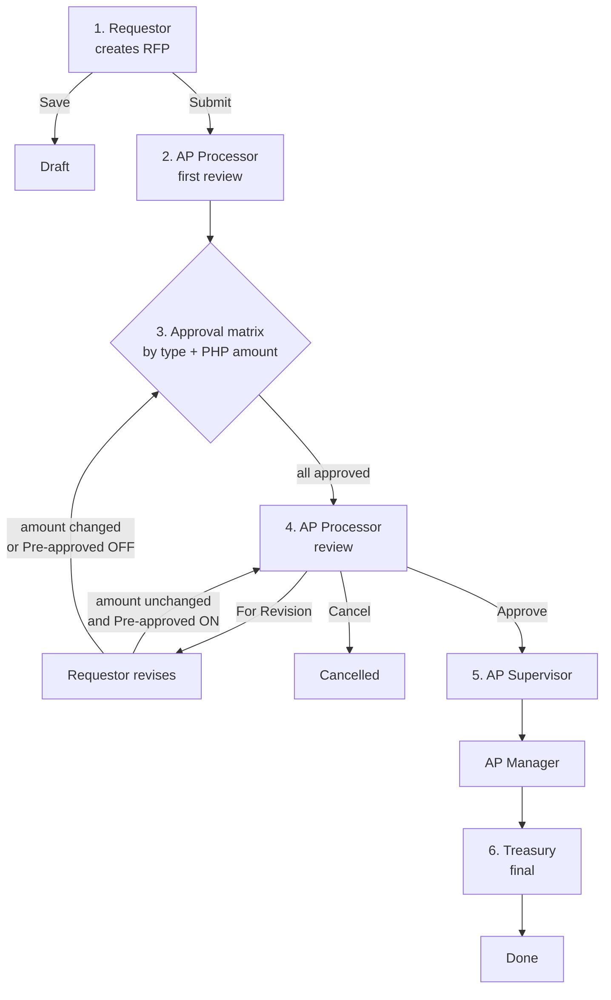

# RFP Approval Flow (2026)

_Last updated: 2026-10-06 · Source: "RFP 2026" flow agreed with the business_

**Summary:** Requestor → AP Processor → Approvers (matrix) → AP Processor → AP Supervisor → AP Manager → Treasury

## 1. Flow diagram

## 2. Steps

| Step | Role | Actions | Next |
|---|---|---|---|
| 1 | **Requestor** (internal employee, or supplier for a down payment only) | Create, save as Draft, submit | Step 2 |
| 2 | **AP Processor** | First review | Step 3 |
| 3 | **Matrix approvers** (see §3) | Approve, in step order | Step 4 |
| 4 | **AP Processor** | **For Revision**, **Cancel**, **Approve** | See §4 |
| 5 | **AP Supervisor**, then **AP Manager** | Approve | Step 6 |
| 6 | **Treasury** | Final | Done |

**Request types:**
- **Standard** (FP&A approvers)
- **Reimbursement** (Line Manager chain)

**Supplier down payment:** the supplier requests the DP (e.g. 10%) as an RFP. The balance (e.g. 90%) is invoiced through P2P.

## 3. Step 3 — Approval matrix

Amounts are the **PHP equivalent**. An amount **exactly on a threshold belongs to the lower tier** (e.g. exactly 10,000 → Line Manager only). Roles in a tier approve **in the order listed**.

### Reimbursement
| PHP amount | Approvers |
|---|---|
| 0 – 10,000 | Line Manager |
| 10,000.01 – 100,000 | Line Manager → Department Head |
| Above 100,000 | Line Manager → Department Head → Division Head → Controller |

### Standard
| PHP amount | Approvers |
|---|---|
| 0 – 1,000,000 | Department Head → BU FP&A |
| 1,000,000.01 – 5,000,000 | BU Head → FP&A Head |
| 5,000,000.01 – 25,000,000 | President → Enterprise Controller |
| Above 25,000,000 | ExCom / Chairman |

### Direct to VP toggle ON (both request types)
| PHP amount | Approvers |
|---|---|
| 0 – 100,000 | Division Head |
| Above 100,000 | Division Head → Enterprise Controller |

**Where it lives:**
- Tables `rfp_approval_rules` + `rfp_approval_rule_steps`
- Edited by Admins under **RFP Settings → Approval Matrix**
- Looked up in code with `ApprovalRule::findFor($requestType, $amountInPhp, $isDirectToVp)`
- Steps with the same step number run **in parallel**

**Rule for the engine (Phase 2.4):** when an RFP enters Step 3, the resolved chain is **copied onto the RFP**. Later edits to the matrix therefore never change RFPs already in flight.

## 4. Step 4 — AP Processor actions

| Action | Effect |
|---|---|
| **For Revision** | Goes back to the Requestor with remarks. The AP Processor can toggle **Pre-approved**. |
| ↳ Pre-approved ON, amount unchanged | Resubmission returns **directly to Step 4** and skips the matrix |
| ↳ Requestor changes the amount (or Pre-approved OFF) | Resubmission goes **back through Step 3** (the matrix is resolved again) |
| **Cancel** | RFP is cancelled. Remarks are required. |
| **Approve** | Goes to Step 5 |

**Cancellation remarks** (AP request, 2026-10-07): whoever cancels (Requestor, matrix approver or AP) must give remarks. They are stored in `rfp_histories` and always visible to AP on the RFP.

**Tax entries** (AP request, 2026-10-07): the Step 4 tax screen shows each invoice's Net of Withholding Tax **and a total of Net of Withholding Tax** for the AP Supervisor's review.

## 5. Step 5 — Accounting review

Always **AP Supervisor → AP Manager**, regardless of amount or currency. (An earlier draft had a 50K threshold; the 2026 revision removed it.)

- Status while with either of them: **For Accounting Approval**. The current approver (AP Supervisor or AP Manager) is shown next to it.
- Actions: **Approve**, or **Return to AP Processor** with remarks (back to Step 4, status For AP Processing). AP request, 2026-10-07.

## 6. Statuses

| Status | Meaning |
|---|---|
| Draft | Saved, not submitted |
| For AP Review | Step 2 |
| For Approval | Step 3 (with the current approver role) |
| For AP Processing | Step 4 |
| For Revision | Returned to the Requestor |
| For Accounting Approval | Step 5, AP Supervisor then AP Manager (current approver shown separately) |
| For Treasury | Step 6 |
| Completed | Treasury done |
| Cancelled | Cancelled at Step 4 |

Every status change writes an approval-history row: who, from/to, remarks, timestamp.
