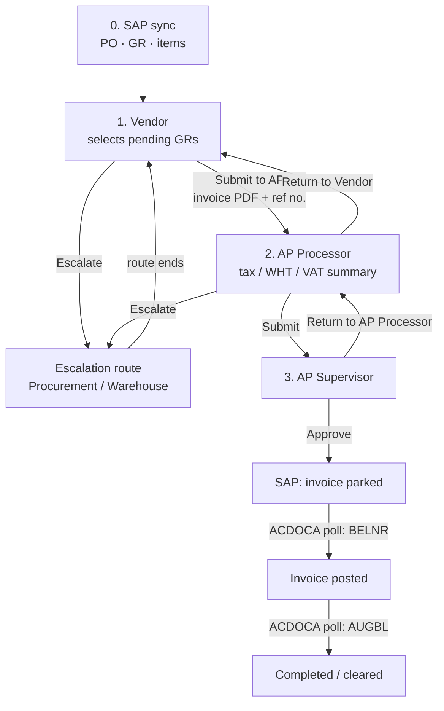

# P2P Flow (to be rebuilt in Phase 3)

_Last updated: 2026-10-06 · Source: P2P master document 261002 (legacy system behaviour)_

This describes the legacy P2P behaviour that we must keep. The **approval and status rules are strict**; screens and tables will be redesigned. Role names below use the new names (see [Roles & users](02-roles-and-users.md)).

## 0. SAP is the source of truth

P2P does not create purchasing data. **POs, GRs and GR items come from SAP** and are read-only in the portal.

- A P2P submission is never typed in from scratch. It **always starts by choosing synced GRs** (one or many, from one vendor/company). The submission is built from those GR lines.
- The vendor adds only what SAP doesn't have: invoice date, reference no(s)., invoice PDF, and which lines/quantities to bill.
- If the SAP data is wrong (quantity, price, UoM, description), the vendor **escalates**; the portal never edits it. Corrections happen in SAP (e.g. Warehouse reverse & re-GR) and come back through the sync.
- Results also come from SAP: the parked invoice number, FI document (`BELNR`) and clearing document (`AUGBL`).

| Data | Direction | SAP source |
|---|---|---|
| Purchase orders (header/items) | SAP → portal | `ZCDS_MM_EKKO`, `ZCDS_MM_EKPO`, `ZCDS_MM_EKET` |
| Goods receipts (+ reversals) | SAP → portal | `ZCDS_MM_MSEG`, `ZCDS_MM_EKBE` |
| Companies, WHT rates | SAP → portal | `ZCDS_FI_T001`, `ZCDS_FI_LFBW`, `ZCDS_FI_T059Z` |
| Invoice park | portal → SAP | SOAP today; AL11 file interface planned (plan 261001) |
| Posting / clearing status | SAP → portal | `ZCDS_FI_ACDOCA` |

## 1. Flow diagram

## 2. Steps

| Step | Role | What happens |
|---|---|---|
| 0 | System | Pull changed POs/GRs from SAP (OData). Daily job at 08:00, plus the vendor's "Sync from SAP" button. GRs land as **pending**. Reversed GRs (BWART 102) are voided. |
| 1 | **Vendor** | **Chooses the synced GR(s) first** (Process / Process Selected); this creates the submission. Then picks the GR lines, enters invoice date, reference no(s). and invoice PDF. **Submit to AP** or **Escalate**. Unselected/partial quantities are split into `-P1`, `-P2` partial GRs. |
| 2 | **AP Processor** | Assigns tax code and WHT code; system computes the VAT/EWT summary. **Submit**, **Escalate**, or **Return to Vendor**. |
| 3 | **AP Supervisor** | **Approve** (park invoice in SAP) or **Return to AP Processor**. |
| 4 | System | Poll SAP ACDOCA: parked → **posted** (FI doc `BELNR`) → **completed** (clearing doc `AUGBL`). |

## 3. Escalations (data-driven routes)

| Reason | Raised by | Route |
|---|---|---|
| Quantity difference | Vendor | Warehouse → Vendor |
| Incomplete GR | Vendor | Warehouse → Vendor |
| Wrong item description | Vendor | Procurement → Vendor |
| Wrong unit of measure | Vendor | Procurement → Vendor |
| Price difference | AP Processor | Procurement → Warehouse (**Reverse & re-GR**) → Procurement → Vendor |
| Other | Any | Procurement → Warehouse → origin |

- One escalation is created per GR, all sharing a batch number.
- The Warehouse hop is routed to Raw Materials or Spare Parts based on the line's storage-location classification.

## 4. Returns & cancellation

| Action | By | Result |
|---|---|---|
| Return to Vendor | AP Processor / Procurement | Vendor corrects and re-submits |
| Return to AP Processor | AP Supervisor | AP Processor corrects and re-submits |
| Return escalation | Current hop | One hop back; at the first hop, back to the originator |
| Cancel request | Vendor (on a returned request) | Header cancelled; GRs go back to pending |

## 5. UX benchmark — Medius

When the vendor uploads an invoice, the **invoice PDF is shown side by side with the PO/GR lines**. The vendor and AP can then compare quantities, prices and amounts without switching screens. A three-way match badge (PO vs GR vs invoice) is shown on each line.

## 6. Legacy issues not to carry over

| Legacy behaviour | Rebuild |
|---|---|
| Emails and SAP SOAP calls run synchronously and block the UI | Queued jobs and queued mail |
| ACDOCA poll handles only 10 headers per run (~120/hour) | Batch the poll properly |
| Overdue warnings repeat every day | Guard with "warning sent at" |
| Unselected GR items are hard-deleted | Keep an audit trail |
| TLS verification off; XML built by string interpolation | Proper HTTP client, escaped payloads |
| Unauthenticated legacy routes | None. Every route is authenticated or signed. |
