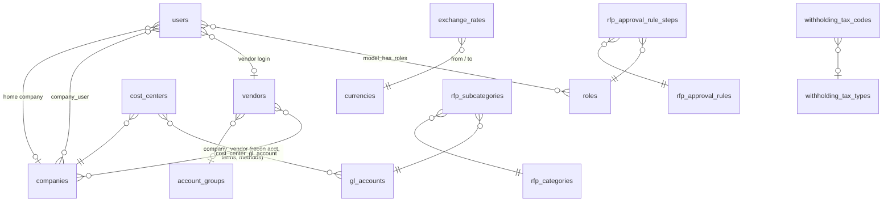

# Data Model

_Last updated: 2026-10-06_

## 1. Principles

- **Shared** tables hold people, access and SAP master data. They have no prefix.
- **Module** tables hold transactions and module-only setup. They are prefixed `rfp_` or `p2p_`.
- Module transaction tables are **never merged**: RFP is for internal users, P2P for external vendors.
- SAP codes are stored as the natural unique key (e.g. `companies.code` = BUKRS), with a surrogate `id` for foreign keys.
- Master data is **deactivated** (`is_active = false`), never deleted, because transactions reference it.
- Statuses and fixed lists are **PHP backed enums** (`app/Enums`), not lookup tables.

## 2. Diagram (current)

## 3. Shared tables

| Table | Purpose | Key columns |
|---|---|---|
| `users` | All logins (employees, approvers, accounting, vendors) | `email`, `company_id` (home), `vendor_id` (vendor logins), `is_active`, soft deletes |
| `roles`, `permissions`, `model_has_roles`, … | Spatie permission | Role names = `App\Enums\RoleName` |
| `company_user` | Companies a user may request or approve for | `company_id`, `user_id` |
| `companies` | SAP company codes | `code` (BUKRS), `name`, `short_name` |
| `currencies` | SAP currency keys | `code` (WAERS) |
| `exchange_rates` | FX rates | `from_currency_id`, `to_currency_id`, `rate`, `valid_from` |
| `account_groups` | SAP vendor account groups | `code` (KTOKK) |
| `payment_methods` | SAP payment methods | `country`, `code` (ZLSCH) |
| `gl_accounts` | SAP G/L accounts | `code` (SAKNR) |
| `cost_centers` | SAP cost centers per company | `company_id`, `code` (KOSTL) |
| `cost_center_gl_account` | G/L accounts allowed per cost center | `expense_group`, `category`, `account_type` |
| `tax_codes` | Input VAT codes | `code` (MWSKZ), `category` (taxable / zero_rated / vat_exempt), `rate` |
| `withholding_tax_types` | SAP WHT types | `code` (WITHT) |
| `withholding_tax_codes` | WHT codes with BIR ATC | `code`, `atc`, `rate`, unique per type |
| `vendors` | SAP vendor master | `code` (LIFNR), `name`, `email`, `tax_number`, `currency`, `last_po_synced_at` |
| `company_vendor` | Per-company vendor data | `reconciliation_account` (AKONT), `payment_terms` (ZTERM), `payment_methods` (ZWELS) |
| `notifications`, `activity_log`, `jobs`, `cache`, `sessions` | Framework | |

## 4. RFP tables

| Table | Purpose |
|---|---|
| `rfp_categories` | Expense categories |
| `rfp_subcategories` | Subcategory → G/L account, SAP document type (BLART), posting key (BSCHL), whether a cost center or PO no. is required |
| `rfp_one_time_vendors` | Vendors not in the SAP vendor master (paid on Reimbursement lines) |
| `rfp_due_types` | Urgent / Standard: `code` (stable, used by code), `processing_days`, `business_days_only`, `is_default`. Sets the RFP due date, counted from submission. Edited under **RFP Settings → Due Types** |
| `rfp_approval_rules` | Step 3 matrix tiers: `request_type` (null = any), `is_direct_to_vp`, `max_amount` (inclusive, null = no limit) |
| `rfp_approval_rule_steps` | Roles per tier with `step_order` (same order = parallel) |
| `rfps` | The request: `rfp_number` (RFP-YYYY-000001), paying company, requestor, `request_type`, `rfp_due_type_id` + `due_date`, `account_group_id` + `vendor_id` (payee; "Final payee" on a Reimbursement), payment method, purpose, `is_direct_to_vp`, `is_pre_approved` + `pre_approval_documents`, `total_php_amount`, `status` (`App\Enums\RfpStatus`), `current_approver_role` (`RoleName`) + optional `current_approver_id` (who must act next; with no person, anyone with the role), `submitted_at`, soft deletes |
| `rfp_items` | Line items (charged to a cost center **or** a PO no., then a subcategory that fits it; see decision 2026-10-07): `sort`, description (item details), subcategory, `gl_account_id` (copied from the subcategory), cost center, invoice no./date, PO no., `currency_id` + `amount` + `exchange_rate` + `php_amount`, `attachments` (private disk paths). Reimbursement only: `company_id`, `vendor_type` (`App\Enums\RfpVendorType`), `vendor_id` / `rfp_one_time_vendor_id` |
| `rfp_histories` | Append-only log: user, `action` (e.g. Approved, Tax codes processed), from/to status (nullable when the action does not change it), remarks |
| _Phase 2.4:_ `rfp_approval_steps` | Snapshot of the resolved approver chain per RFP. To be designed |

## 5. P2P tables (Phase 3, to be designed)

Planned groups, based on the legacy system:
- SAP mirror (purchase orders, goods receipts, GR items)
- Working GRs/items
- Invoice submission header
- Escalations (+ reasons/steps as data)
- Approval histories
- SAP API logs
