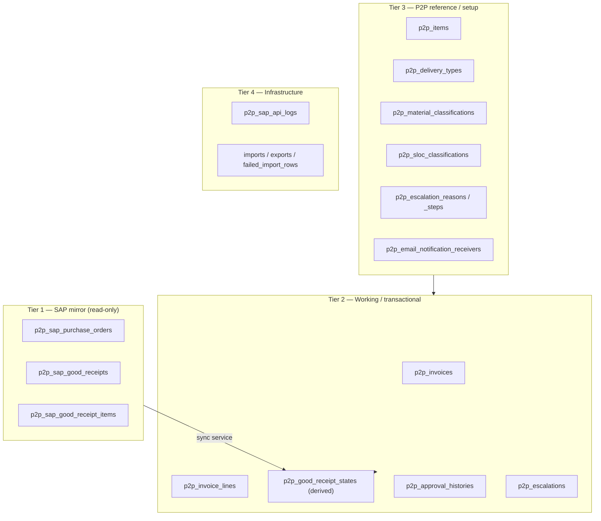

# 2. Data Model

_Last updated: 2026-10-10 · Sources: `../p2p/database/migrations`, `docs/05-data-model.md`_

Follows the app-wide rules: **shared** tables carry no prefix; **module** tables are
prefixed `p2p_`; statuses/fixed lists are **PHP backed enums** (`app/Enums`), not
lookup tables; master data is **deactivated**, never deleted; money is `decimal`.

## 2.1 Four tiers

## 2.2 Shared tables (already exist — reuse, do not recreate)

`companies`, `vendors`, `company_vendor`, `currencies`, `exchange_rates`,
`account_groups`, `payment_methods`, `gl_accounts`, `cost_centers`, `tax_codes`,
`withholding_tax_types`, `withholding_tax_codes`, `users` + Spatie roles,
`notifications`, `jobs`/`cache`/`sessions`, `activity_log`.

> Migration `2026_10_06_161618_update_master_data_columns_for_p2p.php` already widened
> `companies`, `vendors`, `tax_codes` and `withholding_tax_codes` for P2P. Verify against
> it before adding columns.

## 2.3 New P2P tables

### Tier 1 — SAP mirror (written only by sync services)

| Table | Key columns (SAP field) |
|---|---|
| `p2p_sap_purchase_orders` | `status_id`, `company_code` (BUKRS), `purchase_order` (EBELN), `purchase_order_item`, `vendor` (LIFNR), `purchase_order_date` (BEDAT), `purchase_order_type` (BSART), `changed_on` (AEDAT), `created_by` (ERNAM), `currency_key` (WAERS), `total_amount`, `gr_numbers` (json), `quantity_po_balance`, down-payment columns |
| `p2p_sap_good_receipts` | `purchase_order`, `company_id`, `vendor_id`, `good_receipt_number` (MBLNR), `reference_number`, `amount_total`, `due_at`, `date_at`, `delivery_type_id` |
| `p2p_sap_good_receipt_items` | `sap_good_receipt_id`, `purchase_order`, `purchase_order_item`, `item_id`, `material_doc_year` (MJAHR), `material_doc_item` (ZEILE), `storage_location` (LGORT), `item_name`, `item_description`, `quantity_po`, `quantity_served`, `uom`, `unit_cost`, `amount`, `quantity_po_balance` |

### Tier 2 — Working / transactional (the normalized core)

| Table | Role |
|---|---|
| `p2p_invoices` | **The submission** (legacy `good_receipt_headers`). **Authoritative workflow status.** Invoice header, refs, attachments, tax summary, SAP parked/posted/cleared refs |
| `p2p_invoice_lines` | What is billed: FK to `p2p_invoices` + `p2p_sap_good_receipt_items`, `quantity_billed`, `unit_cost`, `amount`, tax inputs |
| `p2p_good_receipt_states` | **Derived** per-GR projection: status enum, quantities served/remaining, reversal info. Recomputed by `GoodReceiptStatusService` (single writer) |
| `p2p_approval_histories` | Append-only transition log (from/to status, actor, remarks, visibility, escalation payload) |
| `p2p_escalations` | One row per escalated GR, sharing a `batch_number`; `current_step_order`, `current_role`, `origin_role`, `status`, `from_status` |

### Tier 3 — P2P reference / setup

| Table | Role |
|---|---|
| `p2p_items` | Item master (soft deletes) |
| `p2p_delivery_types` | Delivery type lookup |
| `p2p_material_classifications` | Classification + owning Spatie role (Raw Materials, Spare Parts, Unclassified…) |
| `p2p_sloc_classifications` | SLOC (company/plant/storage_location) → classification, `description` |
| `p2p_material_classification_user` | Which users may classify which classification |
| `p2p_escalation_reasons` | Reason master: `code`, `name`, `origin_role`, `is_active`, `sort` |
| `p2p_escalation_reason_steps` | Route hops: `step_order`, `role`, `status_id`, `action_label`, `action`, `override_header_status` |
| `p2p_email_notification_receivers` | Points of Contact for warning mail |

### Tier 4 — Infrastructure

`p2p_sap_api_logs` (SOAP audit; passwords redacted). Filament
`imports`/`exports`/`failed_import_rows` stay **shared** (no prefix).

## 2.4 Legacy → new mapping

| Legacy | New | Change |
|---|---|---|
| `sap_purchase_orders` | `p2p_sap_purchase_orders` | prefix only |
| `sap_good_receipts` | `p2p_sap_good_receipts` | prefix only |
| `sap_good_receipt_items` | `p2p_sap_good_receipt_items` | prefix only |
| `good_receipt_headers` | `p2p_invoices` | renamed; still the submission |
| `good_receipts` | `p2p_good_receipt_states` | becomes a **derived** projection, no independent workflow |
| `good_receipt_items` | `p2p_invoice_lines` | now a billing line against a mirror item (bill by quantity) |
| `approval_histories` | `p2p_approval_histories` | prefix; header FK renamed |
| `escalations` / `_reasons` / `_steps` | `p2p_escalations` / … | prefix only |
| `good_receipt_statuses` | — | **dropped** → `App\Enums\P2pStatus` |
| `tax_codes`, `withholding_tax_codes` | shared | already exist; map fields |
| `vendors`, `companies`, `company_user` | shared | already exist |
| `items`, `delivery_types`, `email_notification_receivers` | `p2p_items`, `p2p_delivery_types`, `p2p_email_notification_receivers` | prefix |
| `material_classifications`, `sloc_classifications`, `material_classification_user` | `p2p_*` | prefix |

## 2.5 The normalization

**Problem.** Legacy keeps **two independent status machines** — `good_receipts.good_receipt_status_id`
and `good_receipt_headers.status_id` — synced by hand, with no DB constraint. Partial
billing clones GR rows (`-P1`, `-P2`) and queries match `LIKE '{base}-P%'`. Unsubmitted
items are hard-deleted.

**Target.**

1. **One workflow owner.** `p2p_invoices.status` (enum) is authoritative; every transition writes `p2p_approval_histories`.
2. **Bill by quantity.** `p2p_invoice_lines.quantity_billed`; remaining = mirror qty − Σ billed. A line is billable while remaining > 0.
3. **GR status is derived.** `GoodReceiptStatusService` computes Pending / Partially Billed / Billed / Returned / Escalated / Reversed from invoice lines + escalations, recomputed in the same `DB::transaction`. Optionally cached in `p2p_good_receipt_states` (single writer → no drift).
4. **Mirror untouched** so SAP stays authoritative.

**Partial + escalation still work.** Multiple invoices per GR are supported; escalation
stays per-GR (batch number for multi-GR), records `from_status` for the return, and
"partially escalated" is derived on the header instead of a competing stored status.

## 2.6 Partial-GR number mapping (open)

If SAP requires the physical `-P` partial number (e.g. in `gr_numbers` / ACDOCA), store
it on the line as `sap_partial_gr_number` and map on push — we do **not** clone local
rows to obtain it. To confirm with the SAP team; see `09-open-questions.md`.

## 2.7 Enums

| Enum | Values / notes |
|---|---|
| `P2pStatus` | GR/header workflow — **replicate legacy IDs 1–21** (see `06-workflow-statuses.md`) |
| `P2pPurchaseOrderStatus` | PO status derived by `PurchaseOrderStatusService` (0 Pending / 2 Partially / 3 Fully / 1 Completed) |
| `P2pThreeWayMatchStatus` | Match / mismatch states |
| `P2pDownPaymentStatus` | Down-payment lifecycle |

> Material buckets are **not** an enum — they are dynamic, so they live in the
> `p2p_material_classifications` table and invoice lines reference it via
> `p2p_material_classification_id` (see §2.3).

Role names continue to use `App\Enums\RoleName` (never string literals).

## 2.8 Money & quantity precision

Quantity columns mirror the P2P source: **whole units are `integer`**; only the
aggregate columns the legacy schema defines as decimal are `decimal(15,2)`.

| Group | Type |
|---|---|
| `quantity_po`, `quantity_served`, `quantity_po_balance`, `quantity_billed`, `quantity_total` | **integer** |
| `quantity_previously_served`, `quantity_remaining`, `quantity_submitted` | `decimal(15,2)` (legacy parity) |
| `p2p_invoices` tax/total fields | `decimal(15,2)` |
| `p2p_invoice_lines` `unit_cost` / `amount` | `decimal(15,2)` |
| SAP mirror amounts | SAP source scale |

Never floats. Compare approval/threshold values on the PHP amount.
