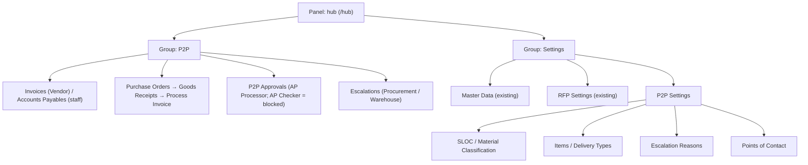

# 4. Filament UI

_Last updated: 2026-10-10 · Target: Filament 5 / Livewire 4 (panel `hub`)_

The legacy P2P screens (Filament 4) are a **behaviour spec**; their APIs do not carry
over. Everything is rebuilt on Filament 5 / Livewire 4.

## 4.1 Navigation map

> `RFP Approvals` (group `RFP`) and RFP Settings are **not** part of this pass. The
> panel's `navigationGroups` gains `P2P` (and keeps `RFP`, `Settings`, `Help`).

## 4.2 Resources

| Resource | Model | Nav label | Access | Notes |
|---|---|---|---|---|
| `PurchaseOrderResource` | `P2pSapPurchaseOrder` | Purchase Orders | Admin, Vendor (nav) | Header "**Sync from SAP**" action; bulk-select POs → open their GRs ("View GR's" / "Process Selected") |
| `GoodsReceiptResource` | `P2pSapGoodReceipt` (or state projection) | Goods Receipt | Admin, Vendor | Nav hidden; reached via PO link / redirect |
| `InvoiceResource` | `P2pInvoice` | **Invoices** (Vendor) / **Accounts Payables** (staff) | Vendor + staff | The submission worklist; label by role |
| `P2pApprovalResource` | `P2pInvoice` | P2P Approvals | AP Processor (+ AP Checker later) | Nav **count badge**; scoped to the user's actionable queue |
| `EscalationResource` | `P2pEscalation` | Escalations | Procurement, Warehouse* | Resolve hops |
| `VendorResource` | `Vendor` | Vendors | Admin | **Existing** (Master Data) |
| P2P Settings resources | `P2pMaterialClassification`, `P2pItem`, `P2pDeliveryType`, `P2pEscalationReason`, `P2pEmailNotificationReceiver` | see §4.1 | Admin | Under `P2P Settings` cluster |

Follow the existing resource structure convention (`{Resource}.php`, `Pages/`, `Schemas/`,
`Tables/`) as in `app/Filament/Resources/Rfps/`.

## 4.3 Custom pages (Bulk + side-by-side viewer)

| Page | Roles | Purpose |
|---|---|---|
| `BulkGoodsReceipt` | Vendor | Select GR lines/quantities, invoice date, reference no(s), upload invoice PDF, see the **3-way-match badge**, **Submit to AP** or **Escalate** |
| `BulkAccountsPayable` | AP Processor (Checker later, Procurement) | Review a submission; assign tax/WHT; **Submit**, **Escalate**, **Return to Vendor** |
| `AccountsPayableProcessorPage` | AP Processor | Thin wrapper loading the processor Livewire sections |

### Medius-style side-by-side viewer (decision #6)

On `BulkGoodsReceipt` and `BulkAccountsPayable`, the uploaded **invoice PDF renders
side by side** with the PO/GR lines so quantities, prices and amounts can be compared
without switching screens. A three-way-match badge (PO vs GR vs invoice) shows per line.
Rebuild as Livewire 4 components (legacy `AccountsPayableProcessor{FormTop,FormRight,Table}`).

### Multi-PO / multi-GR submissions (confirmed against the live system)

Verified on `p2p.test` (vendor KatArt Corp): a vendor processes **one submission across
multiple GRs — and multiple POs — at once**. The flow is:

1. **Purchase Orders** list: each row has a checkbox and a **"View GR's"** link; a PO
   can carry several GRs (plus partials like `-P1`, `-P3`).
2. Selecting POs / opening GRs passes `purchase_orders[]` and `gr_numbers[]` query arrays
   to the **Goods Receipts** list.
3. **Goods Receipts** list (nav hidden): per-status tabs (Pending, Submitted to AP,
   Escalate to Procurement, Rejected/Reversed, Returned to Vendor, Posted to SAP, All),
   per-row **Process**, and a bulk **"Process Selected"** ("N records selected").
4. **`BulkGoodsReceipt`** then processes every selected GR's lines in **one** submission.

Our normalized model supports this natively: a submission (`p2p_invoices`) stores
`po_numbers[]` and `gr_numbers[]`, and `p2p_invoice_lines` bill per GR item — so one
invoice can span several POs and GRs. `P2pGoodReceiptSubmissionService::start()` already
accepts many GR ids and enforces one company + one vendor.

**Build implication:** the vendor "Process" entry point must be the **Goods Receipts
list** (hidden-nav resource) with bulk selection and status tabs, not the PO list. The
PO list links into it. (#32, #33, #36)

## 4.4 Access matrix (this pass)

| Area | Admin | Vendor | AP Processor | Procurement | Warehouse* |
|---|---|---|---|---|---|
| Purchase Orders / Goods Receipts | ✅ | ✅ (own) | — | — | — |
| Invoices / Accounts Payables | ✅ | ✅ (own) | ✅ | — | — |
| P2P Approvals | — | — | ✅ | — | — |
| Escalations | ✅ | — | — | ✅ | ✅ |
| P2P Settings | ✅ | — | — | — | — |

Access is enforced with `canAccess()` / `shouldRegisterNavigation()` (as existing
resources do) plus policies — **never** UI-only.

## 4.5 Exports & Blade components

- `P2pInvoiceExporter` — CSV/Excel export of AP headers (Filament `exports` table).
- Blade: `p2p-approval-history-timeline`, `p2p-form-summarize`, `p2p-open-pdf-link`,
  `p2p-attachments-column`, read-only field helpers — mirror the legacy names under a
  `p2p` prefix.

## 4.6 Dropped screens

`PublicBulkGoodsReceipt` (unauthenticated), `TransactionResource` (disabled),
`SapDataController` debug pages, and the legacy `/db/fresh`, `/insert-*`,
`/purchase-orders/*`, `/vendors/*` routes are **not** ported.
