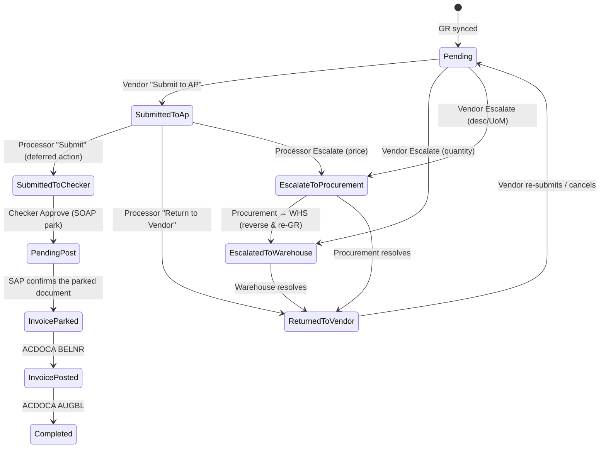

# 6. Workflow & Statuses

_Last updated: 2026-10-10 · Sources: P2P master doc `261002`, `../p2p/docs/05-workflows.md`, `docs/04-p2p-flow.md`_

> Decision #3: **replicate the legacy status IDs** for flow parity, and **document the
> redesign** as a future target (§5). The AP Supervisor (the legacy "checker") and the
> SAP park/ACDOCA steps are now implemented behind `SAP_ENABLED`; see
> [SAP integration](07-sap-integration.md).

## 1. Actors

| Actor | App role (`RoleName`) | Responsibility |
|---|---|---|
| Vendor | `Vendor` | Submit GRs (invoices), escalate |
| AP Processor | `ApProcessor` | Tax/WHT, advance, return, escalate |
| AP Checker | `ApSupervisor` | Approve (park in SAP) / return to AP Processor |
| Procurement | `Procurement` | Escalation hop (description/UoM, price) |
| Warehouse | `Warehouse`, `WarehouseRawMaterials`, `WarehouseSpareParts` | Escalation hop (quantity, reverse & re-GR) |
| System | scheduler/jobs | Sync, ACDOCA, warnings |

## 2. GR / invoice statuses (`P2pStatus`)

Replicate legacy IDs. Statuses `3, 5, 7, 11` are **reserved/legacy** and not driven.

| ID | Key | Meaning |
|---|---|---|
| 1 | `Pending` | Not yet submitted (editable by vendor) |
| 2 | `SubmittedToAp` | Vendor submitted to AP |
| 3 | `ApReview` | (reserved) |
| 4 | `SubmittedToChecker` | Processor forwarded to checker |
| 5 | `CheckerReview` | (reserved) |
| 6 | `Completed` | Cleared in SAP (`AUGBL`) |
| 7 | `RejectedLegacy` | (legacy) |
| 8 | `EscalatedByVendor` | Vendor-raised (coarse legacy status) |
| 9 | `EscalatedByProcessor` | Processor-raised (coarse legacy status) |
| 10 | `EscalateToProcurement` | Procurement hop |
| 11 | `Approved` | (reserved) |
| 12 | `Rejected` | Checker rejection |
| 13 | `InvoiceParked` | SOAP PARK succeeded |
| 14 | `InvoicePosted` | FI document created (`BELNR`) |
| 15 | `ReturnedToVendor` | Sent back to supplier |
| 16 | `ReturnedToApProcessor` | Checker/Procurement sent back to AP |
| 17 | `Cancelled` | Vendor cancelled a returned request |
| 18 | `EscalatedToWarehouse` | Warehouse hop |
| 19 | `PartiallyEscalated` | Header-only aggregate (some GRs escalated) |
| 20 | `Reversed` | GR reversed in SAP (void) |
| 21 | `PendingPost` | (planned) AL11 file pushed, awaiting ack |

## 3. State machine (this pass, up to AP Processor)

> The checker screen, SOAP park and ACDOCA poll are implemented. `SAP_ENABLED=false`
> keeps the workflow on demo data: approval stops at `21 PendingPost` and no network
> call is made.

### Transition reference

| From | To | Trigger | Service |
|---|---|---|---|
| 1 | 2 | Vendor Submit to AP | `P2pGoodReceiptSubmissionService` |
| 1 | 18 / 10 | Vendor Escalate | `P2pEscalationRoutingService::startPerGoodReceipt()` |
| 2 | 4 | Processor Submit | `BulkAccountsPayable` (processor branch) |
| 2 | 15 | Processor Return to Vendor | `P2pGoodReceiptReturnService` |
| 2 | 10 | Processor Escalate | `P2pEscalationRoutingService` |
| 4 | 21 | Checker Approve (queued for SOAP park) | `P2pInvoiceParkingService` |
| 21 | 13 | SOAP returned `INVOICEDOCNUMBER` | `P2pInvoiceParkingService` |
| 4 | 16 | Checker Return to AP Processor | `P2pGoodReceiptReturnService` |
| 13 | 14 | ACDOCA `BELNR` | `P2pInvoiceStatusPollService` |
| 14 | 6 | ACDOCA `AUGBL` | `P2pInvoiceStatusPollService` |
| 8/9/10/18 | previous | Hop resolve | `P2pEscalationRoutingService` (uses `from_status`) |

Every transition writes `p2p_approval_histories` (actor, from/to, remarks, visibility).

## 4. Partial submission (normalized)

Legacy clones GRs into `-P1`, `-P2`. **Redesign:** keep the base GR as the pending
container and clone only the selected quantity onto a local split.

1. Vendor selects lines and enters served quantities.
2. The base GR stays Pending. The selected quantity is cloned onto `{GR}-P{n}`; the base keeps the remainder (`quantity_split_out` tracks the copy).
3. `p2p_invoice_lines.quantity_billed` bills the split item. Remaining on the base stays billable for a later submission.
4. `P2pGoodReceiptStatusService` recomputes the split's GR state (Pending / Submitted / Returned / Escalated / Reversed) inside the same `DB::transaction`.
5. A vendor cancellation merges the split back into its base GR. Returning to vendor, rejecting, reversing and re-GR do **not** merge.
6. Split numbers are per base GR and never reused. The `-P{n}` suffix is stripped from all SAP payloads.
7. PO status is recalculated on every change; empty base GRs are ignored.

Escalations remain per-GR (batch number for multi-GR); a header with mixed GR states derives
`PartiallyEscalated` (19).

## 5. Documented redesign (future target)

Kept out of this pass to preserve parity, but recorded for a later cleanup:

1. **Collapse the two status machines** into the derived `P2pGoodReceiptState` (§4) — already the plan here.
2. **Rename statuses for clarity** and drop reserved IDs `3, 5, 7, 11`; split the two
   legacy `Rejected` meanings (7 vs 12) into distinct keys.
3. **Separate escalation state from workflow status** — escalation is its own axis
   (`open`/`resolved`), not several coarse `EscalatedBy*` statuses.
4. **Derive `PartiallyEscalated`** instead of storing it.
5. **Explicit terminal states** and a single transition table enforced by the service.

## 6. Edge cases to preserve

| Case | Behaviour |
|---|---|
| Repeated/overlapping submit | Row-locked in a `DB::transaction`; double approval impossible |
| Rejected/returned line | Becomes billable again (remaining recomputed) |
| Reversed GR (`BWART 102`) | Marked `20`; replacement GR linked; open escalations auto-resolved |
| Duplicate sync | `Cache::add()` dedup per vendor; in-progress GRs skipped |
| Overdue warning | Guarded by `warning_sent_at` (no daily repeats) |
