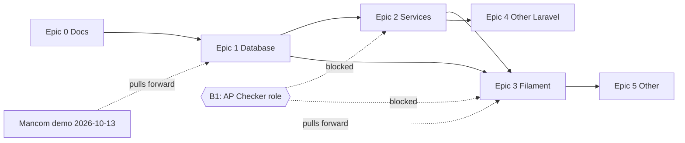

# P2P Work Items (gh-issues)

_Last updated: 2026-10-10 · Generated from [../](README.md) Phase 0_

Ready-to-create GitHub issues, grouped by epic. Create bigger items as **sub-issues**
of their epic. Repo: `github.com/regideon/ramcarspendflow`.

## Labels

| Label | Meaning |
|---|---|
| `P2P` | P2P-only work |
| `RFP` | RFP-only work |
| `P2P` + `RFP` | Unified/shared feature (nav, users, roles, master data, approval engine, notifications) |
| _(none)_ | Brand-new feature belonging to neither (infra, tooling, docs) |

Suggested supporting labels (optional): `phase-1`…`phase-5`, `blocked`, `epic`, `demo`.

## Epics

| Epic | Phase | Labels | File |
|---|---|---|---|
| 0 — Documentation | 0 | — | this repo |
| 1 — Database | 1 | P2P (+ RFP shared) | [epic-1-database.md](epic-1-database.md) |
| 2 — Services | 2 | P2P | [epic-2-services.md](epic-2-services.md) |
| 3 — Filament | 3 | P2P | [epic-3-filament.md](epic-3-filament.md) |
| 4 — Other Laravel | 4 | P2P | [epic-4-other-laravel.md](epic-4-other-laravel.md) |
| 5 — Other | 5 | P2P | [epic-5-other.md](epic-5-other.md) |

## Dependency graph

## Blockers carried from Phase 0

- **B1** — Which RFP role is AP Checker? Build stops at **AP Processor** until answered.
- **B2** — Checker return target for P2P.
- **C5** — Tuesday demo scope (data only vs working screens).

See [../09-open-questions.md](../09-open-questions.md).
